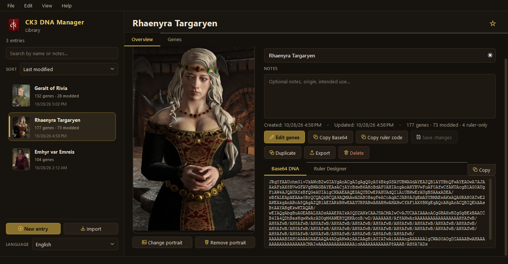
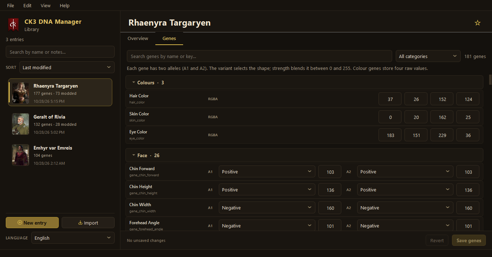
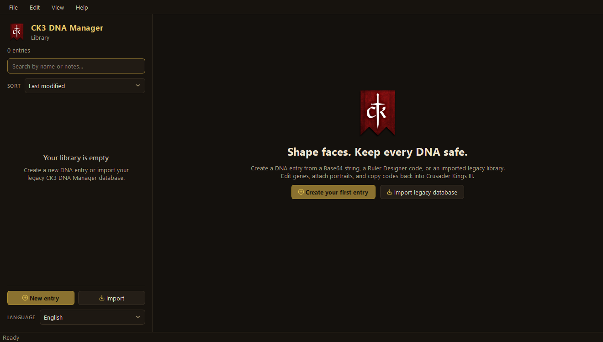
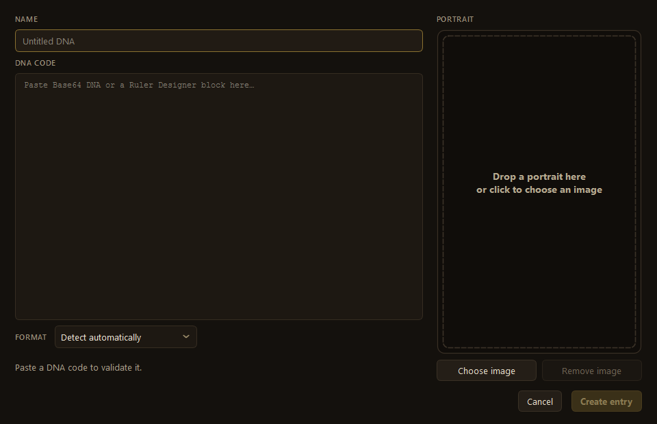

# CK3 DNA Manager (Qt)

A native, local-first reimplementation of the Electron **CK3 DNA Manager** for
Windows and Linux. It stores Crusader Kings III DNA codes and portraits in a
SQLite library, converts between modern Base64 DNA, legacy Base64 DNA and Ruler
Designer code, and gives every gene a proper editor.

The interface is dark, warm and compact: a searchable library on the left, the
selected character on the right, and a dedicated gene editor for detailed work.

## Download

Get the latest Windows and Linux builds from the
[GitHub Releases page](https://github.com/grnnk/CK3-DNA-Manager-Qt/releases).

- **Windows:** extract the `.zip` and run `CK3 DNA Manager Qt.exe`.
- **Linux:** make the `.AppImage` executable and run it. The `.tar.gz` contains
  the same bundled application as a folder.

No installer, account, cloud service or telemetry is required.

## Web version

A static browser build lives in [`web/`](web/) and is published to
[GitHub Pages](https://grnnk.github.io/CK3-DNA-Manager-Qt/). It mirrors the Qt
interface and the DNA/Ruler Designer codec, but stores its library in the
browser instead of SQLite.

- **No runtime build step.** Plain HTML, CSS and ES modules; GitHub Pages
  serves the `web/` folder directly. A generated `standalone.bundle.js` also
  lets `index.html` run when opened directly from disk.
- **Local-first.** Entries, settings and portraits live in `localStorage`
  under the `ck3dna.v1.*` namespace.
- **Same JSON format.** Import and export use the desktop app's
  `ck3-dna-manager-qt` schema, so libraries move both ways.
- **Read-only `.db` import.** Chromium-based browsers can import the desktop
  `dna.db` through a bundled `sql.js` reader. The desktop database is never
  modified.
- **Optional folder sync.** In browsers with the File System Access API
  (Chrome/Edge), connect the desktop data folder. The web app reads
  `web-sync/library.json`, or imports `dna.db` once when that file is absent,
  and writes later changes to `web-sync/library.json`. The folder handle is
  remembered in IndexedDB; the browser may ask for permission again after a
  restart.

Browser storage is per origin and per browser. Clearing site data, using a
private window, or switching browsers starts from an empty library, so export
JSON backups regularly. Safari and Firefox can use localStorage, JSON
import/export and `.db` import, but not direct folder sync.

To run the web build locally, either open `web/index.html` directly or serve
the folder over HTTP:

```bash
cd web
python -m http.server 8765
```

Then open <http://127.0.0.1:8765/>. Opening `index.html` from disk uses the
generated `standalone.bundle.js`, which embeds the gene catalog, translations
and SQLite WASM so `file://` restrictions do not block the app. The HTTP build
loads the source modules directly.

After changing files under `web/js` or `web/assets`, regenerate the standalone
bundle:

```bash
node web/tools/build-standalone.mjs
```

Codec and import tests run with Node:

```bash
node --test web/tests/codec.test.mjs web/tests/import.test.mjs web/tests/folder-store.test.mjs
```

The Pages deployment workflow is
[`.github/workflows/pages.yml`](.github/workflows/pages.yml).



## User guide

### Highlights

- **Local SQLite library.** Data stays on your machine and can be backed up or
  moved like any other file.
- **Every important DNA format.** Paste modern Base64, legacy Base64 or a Ruler
  Designer block. Copy either Base64 or Ruler Designer text back to the
  clipboard.
- **Complete gene editing.** 104 vanilla Base64 slots plus modded extra slots,
  two alleles per morph gene, strength values, RGBA colours, and the
  Ruler-Designer-only beard and hairstyle genes.
- **Portraits.** Drag and drop PNG, JPG, WebP, BMP or GIF images, or paste one
  from the clipboard with `Ctrl+V`. Thumbnails are generated automatically.
- **Library tools.** Names, notes, favourites, live search, sorting, duplicate,
  delete, single-entry export and full-library export.
- **Thirteen languages.** English, German, French, Chinese, Russian, Spanish,
  Portuguese, Polish, Japanese, Korean, Italian, Swedish and Turkish,
  switchable at runtime.
- **Keyboard-friendly.** See the shortcut table below.

### Screenshots



| First launch | New DNA entry |
| --- | --- |
|  |  |

### Data storage

| Item | Location |
| --- | --- |
| DNA library (Windows) | `%APPDATA%\CK3 DNA Manager Qt\dna.db` |
| DNA library (Linux) | `~/.local/share/CK3 DNA Manager Qt/dna.db` (or `$XDG_DATA_HOME`) |
| SQLite journal files | `dna.db-wal`, `dna.db-shm` next to the database |
| Settings (Windows) | `HKEY_CURRENT_USER\Software\CK3 DNA Manager Qt\CK3 DNA Manager Qt` |
| Settings (Linux) | `~/.config/CK3 DNA Manager Qt/CK3 DNA Manager Qt.conf` (or `$XDG_CONFIG_HOME`) |
| Portraits | PNG/thumbnail BLOBs inside `dna.db` |

Use **File > Open data folder** to open the library directory. To back up the
library, close the application first and copy all three `dna.db*` files. A copy
made while the app is running may omit recent WAL data.

On Windows, the app migrates an existing library and settings from the
pre-1.0.1 `%APPDATA%\Welshtokki\CK3 DNA Manager` location on first launch.

### Importing and exporting

- **New entry** (`Ctrl+N`) accepts Base64 DNA or a Ruler Designer `genes={ ... }`
  block. The format selector defaults to automatic detection.
- **Import library or character** (`Ctrl+Shift+O`) accepts an original
  `CK3_DNA_DB.json` or a JSON file exported by this app.
- **Export current entry** (`Ctrl+E`) and **Export all entries**
  (`Ctrl+Shift+E`) write JSON backups.
- **Copy Base64** (`Ctrl+Shift+C`) and **Copy Ruler code** (`Ctrl+Shift+R`)
  place the current code on the clipboard.

When importing the original Electron app's `CK3_DNA_DB.json`, portraits are read
from an `img` folder next to the JSON file. They are copied into the database,
so the original folder is not needed afterwards.

App exports preserve names, notes, favourites, timestamps, embedded portraits,
Ruler metadata and modded keys. They are intended for backup and interchange,
not as a CK3 save-file format.

### Portrait formats

PNG, JPG, BMP and GIF work through Qt. WebP requires the Qt Image Formats
plugin on Linux; the AppImage bundles it. Windows 11 includes WebP support; on
Windows 10, install the free **Webp Image Extensions** from the Microsoft Store
if WebP files cannot be opened.

### Modded DNA and the gene catalog

The bundled catalog is generated from **CK3 1.20.1.2 (Crozier)**:

- 106 gene definitions in 12 categories.
- 104 genes in the vanilla Base64 payload.
- 2 Ruler-Designer-only genes (`beards`, `hairstyles`) with no Base64 slot.
- 3 leading colour genes (`hair_color`, `skin_color`, `eye_color`) storing four
  raw RGBA values instead of allele pairs.

Accessory gene indices follow the game files: for `eye_accessory`, `0` is
`no_eyes` and `1` is `normal_eyes`; for `teeth_accessory`, `0` is `no_teeth` and
`1` is `normal_teeth`. Using the wrong index makes a character render without
eyeballs or teeth in game.

Each morph gene occupies four bytes:

```text
[allele 1 variant, allele 1 strength, allele 2 variant, allele 2 strength]
```

A vanilla payload is therefore 416 bytes (104 × 4). Modded payloads may append
extra genes. CBO (Carnalitas) adds 13 genes, so its characters carry 117 slots
and 624-character Base64 strings. Unknown trailing slots are preserved,
editable and written back unchanged.

Ruler Designer imports preserve every key in the `genes={ ... }` block,
including modded keys that are not in the bundled catalog. Vanilla Ruler-only
fields (`beards`, `hairstyles`, `clothes`) and `override`/`entity` blocks remain
in the Ruler code but are not added to Base64. Base64 cannot carry modded key
names; use **Copy Ruler code** when the names matter.

Cheat Engine tables built from the vanilla `common\genes\*.txt` files only know
the 104 vanilla genes. Raw-byte paste still works, and extra modded slots are
left untouched.

### Keyboard shortcuts

| Action | Shortcut |
| --- | --- |
| New DNA entry | `Ctrl+N` |
| Save details / genes | `Ctrl+S` |
| Import library or character | `Ctrl+Shift+O` |
| Export current entry | `Ctrl+E` |
| Export all entries | `Ctrl+Shift+E` |
| Copy Base64 DNA | `Ctrl+Shift+C` |
| Copy Ruler Designer code | `Ctrl+Shift+R` |
| Duplicate entry | `Ctrl+D` |
| Search library | `Ctrl+F` |
| Quit | `Ctrl+Q` |

`Ctrl+V` also pastes a portrait from the clipboard. It accepts an image or a
copied `.png`, `.webp` or `.jpg` file. On the welcome screen it opens a new
entry with the image already attached.

## Developer guide

### Requirements

**Windows**

- Windows 10 or 11 (64-bit)
- Qt **6.5+** with Widgets, Sql and Svg (tested with Qt 6.8.3 / MinGW 13.1)
- CMake **3.21+** (3.25+ for the bundled presets)
- Ninja or GNU Make, plus a MinGW-w64 compiler matching the Qt build

**Linux**

- A 64-bit distribution with a C++20 compiler (GCC 11+ or Clang 14+)
- Qt **6.5+** development packages for Widgets, Sql, Svg and Test
- CMake **3.21+** (3.25+ for the bundled presets)
- Ninja or GNU Make
- Optional: `linuxdeploy` and `linuxdeploy-plugin-qt` on `PATH` for AppImage
  packaging

Typical package installation:

```bash
# Debian / Ubuntu
sudo apt install build-essential cmake ninja-build \
  qt6-base-dev qt6-svg-dev qt6-image-formats-plugins libqt6sql6-sqlite

# Fedora
sudo dnf install gcc-c++ cmake ninja-build \
  qt6-qtbase-devel qt6-qtsvg-devel qt6-qtimageformats

# Arch Linux
sudo pacman -S base-devel cmake ninja qt6-base qt6-svg qt6-imageformats
```

`./tools/build.sh --install-deps` installs the Linux packages with the detected
package manager. The Linux build uses the system Qt by default; pass
`--qt-path` or set `QT_ROOT` if Qt is installed elsewhere.

### Build

```powershell
# Windows
.\tools\build.ps1 -Config Release
```

```bash
# Linux
./tools/build.sh
```

Both scripts locate Qt, configure CMake, build the application and tests, and
run the test suite. Ninja is the default; pass `-Generator` or `--generator` to
use a Makefiles generator.

Useful options:

```powershell
.\tools\build.ps1 -Config Debug -SkipTests
.\tools\build.ps1 -Config Release -Generator "MinGW Makefiles"
```

```bash
./tools/build.sh --config Debug --skip-tests
./tools/build.sh --install-deps
./tools/build.sh --generator "Unix Makefiles"
```

Build output:

- Windows: `build\<config>\CK3 DNA Manager Qt.exe` or
  `build\make-<config>\CK3 DNA Manager Qt.exe`
- Linux: `build/linux-<config>/ck3-dna-manager-qt` or
  `build/linux-make-<config>/ck3-dna-manager-qt`

The CMake presets are also available:

```bash
cmake --preset release          # or debug
cmake --build --preset release
ctest --preset release
```

On Linux, use `linux-release`, `linux-debug`, `linux-make-release` or
`linux-make-debug`. On Windows, the presets expect `QT_ROOT` and `MINGW_ROOT`
to be set.

Run the tests directly with:

```powershell
build\release\ck3_tests.exe
```

```bash
ctest --test-dir build/linux-release --output-on-failure
```

Build with `-DBUILD_SCREENSHOTS=ON` (or `build.ps1 -Screenshots` /
`build.sh --screenshots`) to get the `ck3_screenshots` helper used for the
images above. It uses a temporary test data directory.

### Packaging

**Windows**

```powershell
.\tools\deploy.ps1 -Config Release -Zip -Version 1.0.1
```

This creates a self-contained `dist` folder with Qt deployed and writes
`CK3-DNA-Manager-1.0.1-win64.zip` to the project root. Use `-SkipBuild` or
`-SkipTests` to reuse an existing build.

**Linux**

```bash
./tools/deploy.sh --config Release --tar --version 1.0.1
./tools/deploy.sh --config Release --appimage --tar --version 1.0.1
```

- `--tar` alone creates a portable folder and tarball that use the system Qt.
- `--appimage` creates a self-contained AppImage.
- `--appimage --tar` also archives the self-contained AppDir.

AppImage packaging requires `linuxdeploy` and `linuxdeploy-plugin-qt` on
`PATH`; both must be executable. Archives are written to the project root, and
the bundled AppDir is kept at `dist/appimage-release/AppDir`.

Packaged builds use [`docs/PACKAGE_README.md`](docs/PACKAGE_README.md) as their
`README.md`. That short guide covers running the app and locating its data; the
full repository README and screenshot links are not copied into packages.

### Releases

Windows and Linux packages are built by GitHub Actions when a `v*` tag is
pushed. See [`docs/RELEASING.md`](docs/RELEASING.md) for the release checklist,
manual build runs and GitHub Pages setup.

### Project layout

```text
src/
  main.cpp              application bootstrap
  core/                 codec, catalog, database, i18n, image and import logic
  ui/                   main window, gene editor, dialogs, theme and layouts
resources/
  genes.json            modern CK3 gene catalog
  legacy_genes.json     legacy option mapping
  i18n/translations.json
  theme.qss             dark gold theme
  icons/                SVG icons and application icon
  app.desktop           Linux desktop entry
tests/
  test_core.cpp         QtTest suite
  screenshot.cpp        offscreen UI screenshot helper
tools/
  build.ps1             Windows configure, build and test
  deploy.ps1            self-contained Windows deployment with windeployqt
  build.sh              Linux configure, build and test
  deploy.sh             Linux staging, AppImage and tarball deployment
  build_gene_catalog.py
  build_legacy_catalog.js
docs/
  RELEASING.md          release checklist, manual builds and Pages setup
  PACKAGE_README.md     short README copied into packaged builds
.github/workflows/
  pages.yml             GitHub Pages deployment for web/
  release.yml           tagged Windows/Linux builds and GitHub Releases
web/                    static browser build published to GitHub Pages
```

### Regenerating the catalogs

```bash
python tools/build_gene_catalog.py "path/to/Crusader Kings III"
node tools/build_legacy_catalog.js path/to/CK3_DNA_Manager/js/gene_index.js
```

The generated JSON is embedded at build time, so end users do not need Python
or Node.

### Localization

UI strings live in `resources/i18n/translations.json`. Add the language code,
native name and complete key set there; missing keys fall back to English.
Gene keys, gene display names and CK3 option identifiers intentionally remain
in English because they are technical game data.

## Credits

Inspired by the original
[CK3 DNA Manager](https://github.com/Welshtokki/CK3_DNA_Manager) by Welshtokki.
Gene definitions are derived from Crusader Kings III game data.

Crusader Kings III is a trademark of Paradox Interactive. This is an unofficial
fan tool and is not affiliated with or endorsed by Paradox Interactive.

Built with [Qt](https://www.qt.io) and SQLite.

## License

ISC. See [LICENSE](LICENSE). The original project also used the ISC license.
